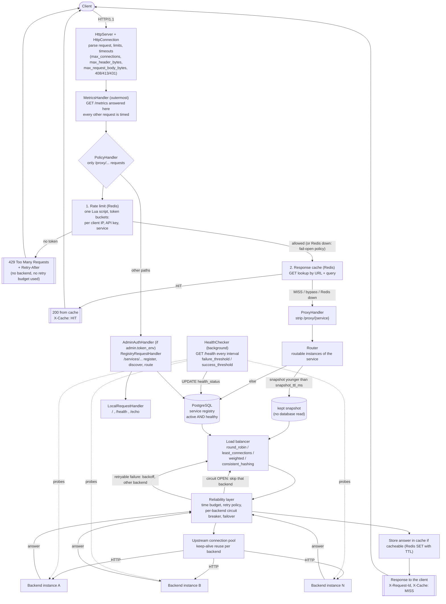

# EdgeFlow request flow

This is the path of one request through the code, in the order the layers run. Every box is a real class or
function; every arrow is a real call. (Written from `src/core/Application.cpp`, which builds the chain, and from
the handlers it chains.)

## The flowchart



## The same flow as text

```
Client
  |
  v
HttpServer / HttpConnection ........ request parsing, size and time limits, keep-alive, connection cap
  |
  v
MetricsHandler ..................... GET /metrics, request timing, error ratio, p50/p95/p99 (observability)
  |
  v
PolicyHandler (only for /proxy/...)
  |-- 1. RateLimiter (Redis EVALSHA)  --> over the limit?  --> 429 + Retry-After        (never reaches a backend)
  |-- 2. ResponseCache (Redis GET)    --> hit?             --> 200, X-Cache: HIT        (never reaches a backend)
  v   (miss)
ProxyHandler  /proxy/{service}/{path}
  |-- Router
  |     |-- kept snapshot of the routable set (routing.snapshot_ttl_ms) ... or ... PostgreSQL (active AND healthy)
  |     '-- LoadBalancer: round_robin | least_connections | weighted | consistent_hashing
  |-- ReliabilityManager
  |     |-- total time budget for the whole request
  |     |-- CircuitBreakerRegistry: one breaker per backend (CLOSED -> OPEN -> HALF-OPEN)
  |     '-- RetryPolicy: backoff + jitter, failover to a backend this request has not tried
  |-- UpstreamPool  (keep-alive connections to each backend)
  v
Backend instance  ---->  answer travels back up the same path
  |
  '-- 2xx cacheable answer: stored in Redis with a TTL; response gets X-Request-Id / X-Cache: MISS

Background, independent of requests
  HealthChecker ---- GET /health on every registered instance ---> UPDATE health_status in PostgreSQL
  (an instance that fails failure_threshold probes in a row stops being routable; success_threshold brings it back)

Not a proxied path
  /services/...  AdminAuthHandler (optional bearer token) -> RegistryRequestHandler -> PostgreSQL
  / , /health , /echo  LocalRequestHandler
```

## Where each concern really sits

| concern | where | code |
|---|---|---|
| HTTP parsing, limits, timeouts | first thing a connection meets | `network/HttpServer`, `HttpConnection` |
| metrics | outermost handler: answers `/metrics`, times everything else | `observability/MetricsHandler`, `Metrics` |
| rate limiting | before the cache and the proxy, shared by all gateway instances through Redis | `ratelimit/RateLimiter`, `gateway/PolicyHandler` |
| caching | after the rate limit (a hit still costs a token), before the proxy | `cache/ResponseCache`, `gateway/PolicyHandler` |
| service discovery | PostgreSQL is the source of truth; the registry API is `/services` | `discovery/PostgresServiceRegistry`, `network/RegistryRequestHandler` |
| health checking | background thread pool, writes `health_status` to PostgreSQL | `discovery/HealthChecker`, `network/HealthProbe` |
| routing | inside the proxy, over active AND healthy instances | `routing/Router`, `routing/*` strategies |
| retry, circuit breaker, failover, time budget | between the load balancer and the connection pool | `reliability/ReliabilityManager`, `CircuitBreaker`, `Retry`, `Failover`; `proxy/ProxyHandler` |
| connection pooling | towards backends | `proxy/UpstreamPool`, `proxy/UpstreamClient` |
| registry protection | in front of the registry API only | `network/AdminAuthHandler` |

## What happens in the three situations that matter

- **A backend dies.** A request sent to it fails (`connection refused`, `not_sent`): the retry policy tries another
  backend at once (failover), the circuit breaker of the dead one opens after `failure_threshold` failures so
  later requests skip it without trying, and the health checker marks it unhealthy after `failure_threshold` missed
  probes, which removes it from the routable set. When it answers again, the circuit half-opens, a probe request
  succeeds, and the health checker marks it healthy again after `success_threshold` probes.
- **Redis is down.** The cache is bypassed (every request is a miss) and the rate limiter follows
  `rate_limit.on_redis_failure` (`allow` = fail open, `reject` = 503). Requests still reach the backends.
- **PostgreSQL is down.** Routing reads fail with 503 once the kept snapshot (if any) is older than
  `snapshot_ttl_ms`; the registry API answers 503; cached answers and rate limiting are not affected.
